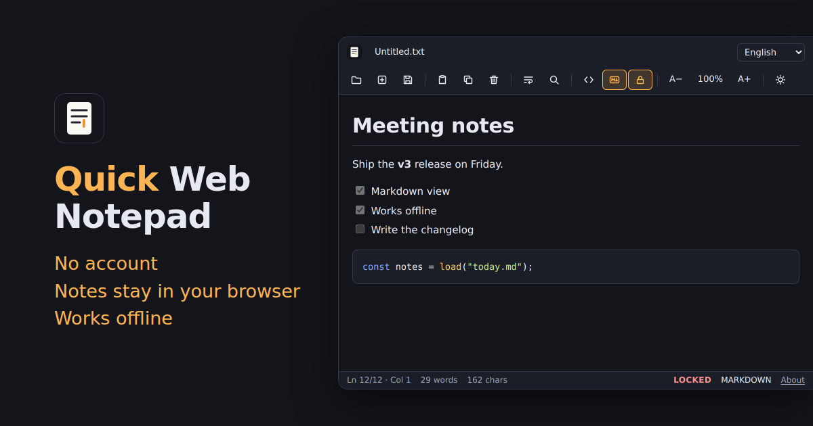

# Quick Web Notepad

Quick Web Notepad is a free, open-source notepad that runs entirely in your browser: no account, notes are not uploaded, and it works offline.

**Use it:** https://qwnotepad.ofcodedev.me/ · [About, shortcuts and FAQ](https://qwnotepad.ofcodedev.me/about.html)



## Features

- Plain text editing; open and save local files (saves in place where the browser supports the File System Access API, otherwise downloads)
- Separate name and extension fields; an empty extension is chosen automatically (`md` in the Markdown view, the detected language in the Syntax view, otherwise `txt`)
- Find and replace with match case and regex
- Syntax view: read-only highlighting for JS, Python, HTML, CSS, JSON, SQL, shell, C, Markdown
- Markdown view: read-only rendered preview (GFM tables, task lists, highlighted code blocks)
- Lock mode to protect the text from accidental edits
- Light and dark themes, zoom, word wrap
- 15 interface languages, detected from the browser
- Installable and usable offline (PWA)
- The text of each tab survives a reload; a new tab always starts empty

## Privacy and limits

- The app has no backend. Your text is processed in the browser and stays on your device.
- The text of a tab is kept in that tab's sessionStorage, so it survives a reload and is discarded when the tab closes. Save to a file to keep it.
- There is no sync, cloud backup or sharing by link.
- The site shows Google AdSense ads, including one thin strip under the editor.

## Shortcuts

| Action | Shortcut |
| --- | --- |
| Open / Save | Ctrl+O / Ctrl+S |
| Find | Ctrl+F |
| Copy all or selection | Ctrl+Shift+C |
| Syntax view | Ctrl+Shift+H |
| Markdown view | Alt+M |
| Lock | Ctrl+Shift+L |
| Word wrap | Alt+Z |
| Zoom | Ctrl+= / Ctrl+− / Ctrl+0 |
| Clear | Esc Esc (Esc ×3 when locked) |

## Project layout

```
index.html              the app page (English, and the template for the language pages)
es/ tr/ ja/ ...         generated per-language copies of the app page; do not edit by hand
_tools/                 build-locales.mjs (generator), locales.mjs (search-result strings), monitor.mjs (search and performance report)
assets/app.css          styles; the color palette is the token block at the top
assets/app.js           app logic (ES module)
assets/i18n.js          interface strings
assets/page.css         styles for the static pages
assets/vendor/          marked and DOMPurify, pinned and served locally
sw.js                   service worker (offline support)
manifest.webmanifest    PWA manifest
about.html              product page: features, storage, shortcuts, comparison, FAQ
privacy.html, contact.html, 404.html
robots.txt, sitemap.xml, llms.txt
index_v1.html, index_v2.html, index_v2.1.html   redirects from the old addresses
```

## Development

Serve the folder with any static server, for example:

```
python3 -m http.server 8000
```

The site is served from the domain root, so paths are root-absolute.

After editing `index.html`, `assets/i18n.js` or `_tools/locales.mjs`, rebuild the language pages and the sitemap:

```
node _tools/build-locales.mjs
```

`node _tools/build-locales.mjs --check` exits with an error if a language page is out of date.

When a cached file list changes, bump `CACHE` in `sw.js`. Keep the version in `assets/app.js`, `index.html` (status bar and JSON-LD) and `about.html` in step.

## Author

Created by OFCode-dev
